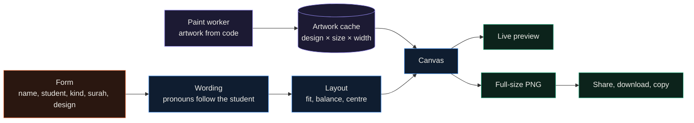
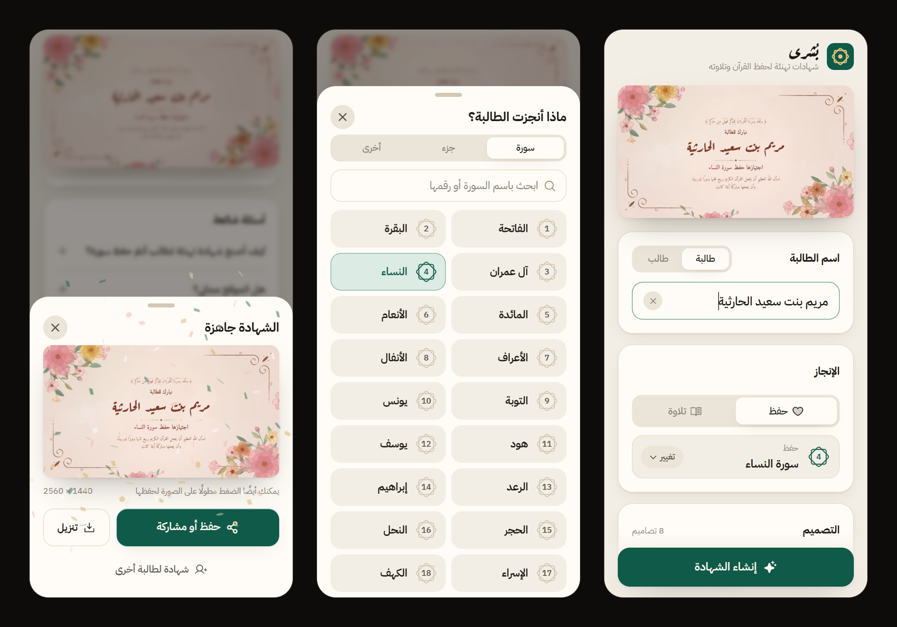

<div align="center">

# Bushra

**Arabic congratulation certificates for Quran students: type the name, pick the surah and a design, download the image.**


</div>

I built Bushra (بُشرى, "glad tidings") for Quran teachers, who send parents a congratulation image whenever a
student passes a surah and usually make each one by hand. You type the student's name, choose memorisation (حفظ) or
recitation (تلاوة), pick the surah and one of fourteen designs, and download the image. The preview updates as you type,
and the download is the same picture at full size. It runs at
[bushra-quran.vercel.app](https://bushra-quran.vercel.app), with no account and no server behind it.

## Highlights

- Fourteen designs, all drawn in code with no image files: watercolor flowers, lavender and an olive wreath; an emerald and gold geometric border, an illuminated mushaf page, Moroccan zellige, a paper-cut mihrab arch and black marble with Art Deco gold; a night sky with lanterns, a desert at sunset and the Omani coast with a dhow; a minimal sheet with a gold seal; and two for children's circles, one pastel and one in space.
- The wording follows the student. "نبارك للطالبة ... اجتيازها" becomes "نبارك للطالب ... اجتيازه", and the closing prayer changes its pronouns with it (`src/lib/wording.ts`).
- A surah, a juz', the whole Quran, or any text you type. Search folds the spellings people mix up (أ/ا, ة/ه, ى/ي), and surah numbers work too.
- The verse at the top matches the achievement: Al-Muzzammil 73:4 for recitation, Al-Qamar 54:17 for memorisation, copied verbatim from the Tanzil Uthmani text.
- Long names shrink to fit, then split over two lines and grow back. The prayer always breaks at its comma, so no line splits "ربيع قلبها".
- Two sizes: 2560×1440 for sharing and 3508×2480 (A4 at 300 dpi) for printing.
- On a phone, "حفظ أو مشاركة" opens the share sheet, so the image goes straight to the gallery or WhatsApp. On a computer it downloads or copies to the clipboard.
- Everything runs in the browser. Names never leave the device, and the app installs to the home screen and works offline.

## How it works



Each design is a `Template`: a `paint` function that draws the artwork and a `layout` that says where the text goes and
in which fonts. The artwork is the slow part, so it runs in a Web Worker on an `OffscreenCanvas` and is cached per
design, format and pixel width. Typing only redraws the text on top, which takes a few milliseconds.

The watercolor designs use Tyler Hobbs's technique: a petal or leaf outline is roughened by recursive midpoint
displacement, then filled 20 to 30 times at a few percent opacity, each fill roughened again and some of them masked
through random holes. The overlaps give soft edges, a deeper core and pooled pigment at the rim. Everything is seeded,
so the preview, the thumbnails and the download are the same picture.

The text is laid out by a small engine in `src/cert/render.ts`. The canvas draws Arabic with the browser's own
shaping, so ligatures, tashkeel and the Uthmani marks in the verse all come out right. Fonts are bundled
(Aref Ruqaa, Amiri, Amiri Quran, El Messiri, Reem Kufi, Lemonada) and loaded for the exact characters before
anything is drawn, because a canvas never waits for a web font.

## Screens



Right to left, as the app reads: the form, with the certificate above it updating as you type; the surah picker,
which also has tabs for a juz' and for the whole Quran or free text; and the result, where the confetti lands and the
image is ready to save. On a wide screen the preview sits beside the form instead of above it.

## Results

Time to finished image on my desktop, at the 2560 px export size:

| Design | Time |
|---|---|
| ورد (watercolor flowers) | 0.75 to 0.9 s |
| زيتون (watercolor olive wreath) | about 0.25 s |
| خزامى (watercolor lavender) | about 0.23 s |
| The other eleven | 75 to 180 ms |

The app is about 175 KB of gzipped JavaScript, plus fonts. The offline cache holds 1.4 MB, most of it the
Arabic font files.

## Quickstart

```bash
pnpm install
pnpm dev        # http://localhost:5173
pnpm build      # type-check and build into dist/
```

In development, `/?render=<design>` draws one certificate at full size, and `/?contact` draws every design side by side.
Both accept `name`, `g=m`, `kind=hifz`, `surah`, `school`, `date`, `noverse` and `format=a4`.

`VITE_SITE_URL` in `.env.production` is the public address used for the canonical link, the link preview image and
the structured data. Change it if you deploy somewhere else.

## Repository map

```
src/
  App.tsx                 the page: form, preview, generate
  components/             segmented control, sheet, surah picker, design picker, result, FAQ
  cert/
    render.ts             text layout and the render entry points
    background.ts         worker pool and artwork cache
    paint.worker.ts       paints artwork off the main thread
    templates/            one file per design
    kit/                  watercolor, ornaments, geometry, paper, sky, tazhib, landscape, deco, space
  lib/
    wording.ts            what the certificate says, by gender and kind
    quran.ts              surah and juz' names, search folding
    verses.ts             the two verses, with Tanzil's notice
    faq.ts                questions shown on the page and published as structured data
public/                   icons, link preview image, robots.txt, sitemap.xml
vercel.json               sends the other Vercel hostnames to the main one
```

## Limitations

- The watercolor designs are slow to paint on older phones; the preview shows a shimmer until the artwork is ready.
- Wording is fixed apart from the achievement line. A school that wants different phrasing has to edit `src/lib/wording.ts`.
- One certificate at a time. A whole class from a pasted list of names would be the next feature.

## License

MIT for the code. The verses are the Tanzil Quran Text (Uthmani 1.1), Creative Commons Attribution 3.0, from
[tanzil.net](https://tanzil.net).
